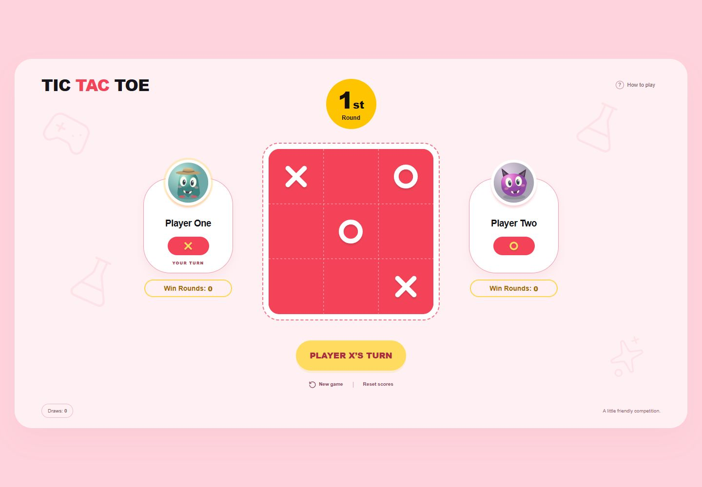
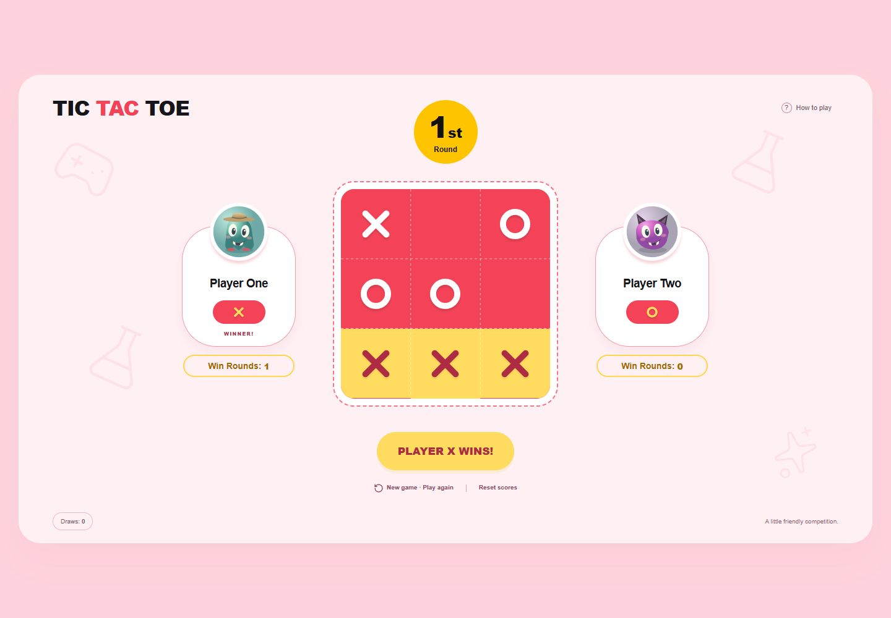
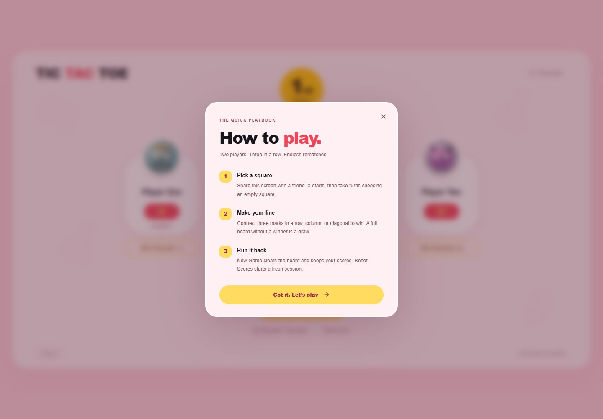
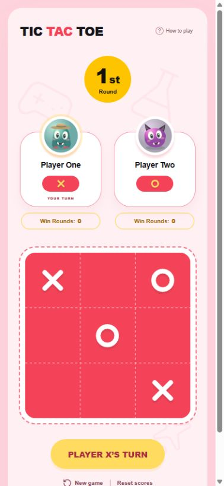

# Tic Tac Toe

A two-player tic-tac-toe game built with React and Next.js. A blush game mat, coral board, original SVG monster avatars, and GSAP animations bring a playful feel to a classic game.

**[Play the live demo](https://tic-tac-toe-hazel-mu-98.vercel.app/)** · **[Browse the source](https://github.com/Incognitomode669/Tic-Tack-Toe)**



## Features

- Local two-player gameplay with alternating X and O turns.
- Win detection for all rows, columns, and diagonals, plus draw detection.
- Highlighted winning squares, player win totals, draw count, and round badge.
- New Game preserves scores; Reset Scores starts a fresh session.
- GSAP entrances, drawn marks, tile feedback, and victory celebrations.
- Animated How to Play modal with Escape/backdrop dismissal, focus handling, and scroll locking.
- Responsive phone, tablet, and desktop layouts with keyboard-accessible controls and announced turn/results.

## Screenshots

These captures show the current repository build. Full-size files are available in [docs/screenshots](docs/screenshots).

| Winning round | Instructions popup |
| --- | --- |
|  |  |



## Run locally

Use Node.js 22.19 or newer (the test command uses Node's TypeScript stripping) and npm.

```sh
npm ci
npm run dev
```

Open http://localhost:3000. No environment variables, accounts, or backend services are needed.

## Play

Two people share one screen. X starts every round. Take turns choosing an empty square; three in a row, column, or diagonal wins. A full board without a winner is a draw. Occupied squares and completed rounds cannot receive moves.

New Game clears the board and retains the session scoreboard. Reset Scores clears the board, scores, and round number. Reloading the page starts a fresh session; no data is stored or transmitted.

The layout adapts to phone, tablet, and desktop screens. Controls support keyboard focus and activation; turn and outcome updates use a live region. GSAP effects are always enabled.

How to Play opens a native modal dialog with GSAP entrance and reversed exit animation. It traps keyboard focus, supports Escape and backdrop dismissal, restores trigger focus on close, and locks background scrolling without moving the board.

## Verify

```sh
npm run lint
npm run typecheck
npm test
npm run build
npm start
```

Tests cover alternating turns, occupied/invalid cells, all eight winning lines for either player, end-of-round locking, score increments, draws, a last-move win, and round/session resets.

## Implementation

- Next.js App Router, React 19, TypeScript, Tailwind CSS 4.
- shadcn/ui Button (Base UI), Lucide icons.
- GSAP and its official React hook: staggered entrance, SVG stroke drawing, mark pop, tile press, turn transitions, winning tile pulses, and particle burst. Animations are scoped and cleaned up on updates and unmount.
- `app/game.ts`: pure game rules and reducer; no browser or network dependency.
- `app/tic-tac-toe.tsx`: interactive game and scoreboard.
- `app/animated-mark.tsx`: SVG X/O symbols with GSAP drawing.
- `app/player-avatar.tsx`: original SVG player avatars.
- `app/rules-dialog.tsx`: animated instructions modal and focus handling.
- `app/game.css`: responsive game and modal styles.
- `tests/game.test.ts`: Node test runner coverage.

The shadcn CLI is a development dependency. `npm audit --omit=dev` reports zero runtime advisories at the initial build. The full audit currently reports low/moderate advisories in development tools; npm proposes breaking tool downgrades, which have not been applied.

## Deployment

The public app URL is [tic-tac-toe-hazel-mu-98.vercel.app](https://tic-tac-toe-hazel-mu-98.vercel.app/). To deploy another instance on Vercel, use the Next.js preset, the `npm run build` command, and default output settings. No environment variables or database setup are required.

## Submission links

- **Test:** 1) Tic-Tac-Toe
- **Live app:** https://tic-tac-toe-hazel-mu-98.vercel.app/
- **Repository:** https://github.com/Incognitomode669/Tic-Tack-Toe
- **Screenshots:** [desktop gameplay](docs/screenshots/desktop-game.jpg), [winning round](docs/screenshots/winning-round.jpg), [instructions](docs/screenshots/how-to-play.jpg), [mobile gameplay](docs/screenshots/mobile-game.jpg).
- **Application form:** https://apply.capm.us

Before submitting, open the public app URL without signing in and verify a winning round, a draw, and New Game. A demo recording and reviewer notes are optional.
